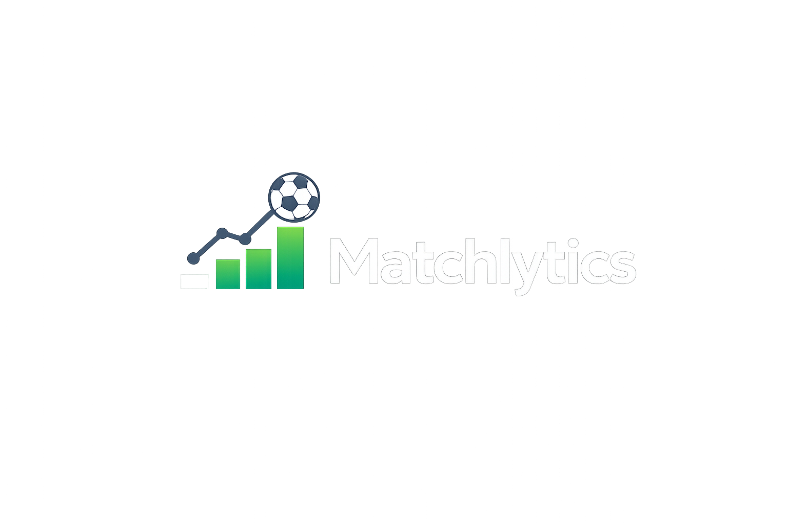
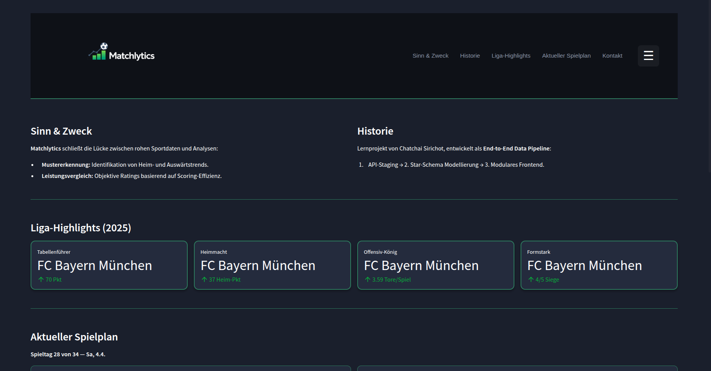
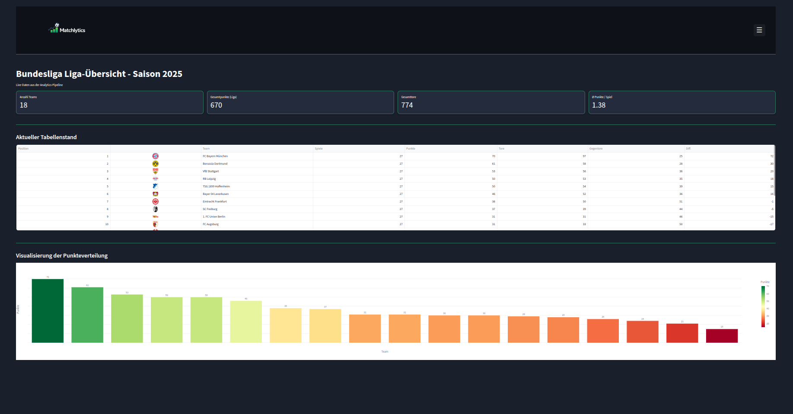
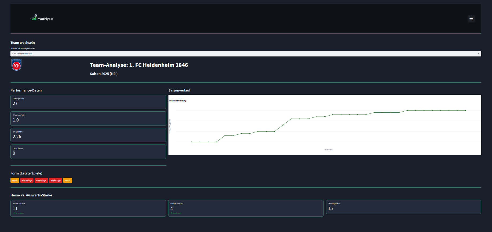
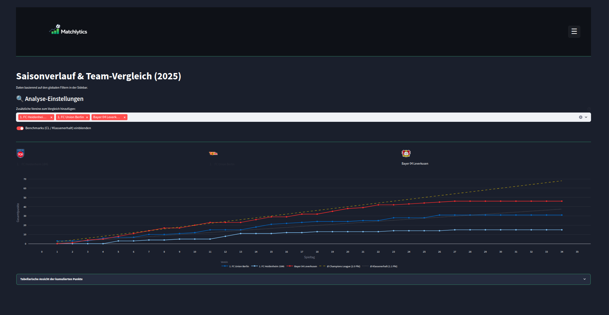
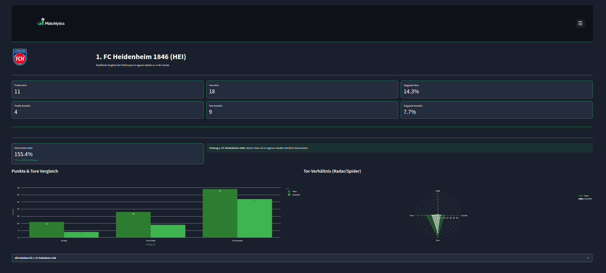
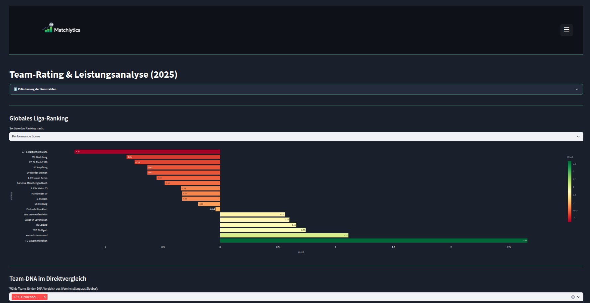
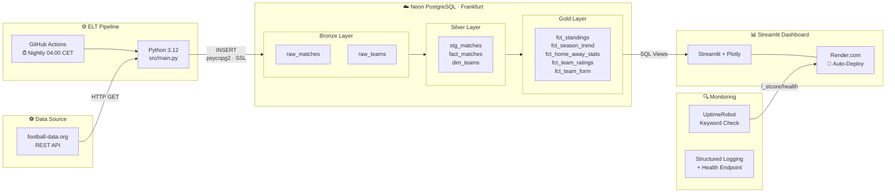

<div align="center">
  

  <h1>Matchlytics – Bundesliga Data Pipeline & Dashboard</h1>

  <p>
    <strong>End-to-end ELT pipeline</strong> that ingests live Bundesliga data nightly,<br>
    transforms it through a <strong>Medallion Architecture</strong> and serves interactive analytics.
  </p>

  <!-- Badges -->
  <p>
    
    
    
    
    
    
    
    
    
    
  </p>

  <p>
    <a href="https://github.com/Chatchai-lab/football-data-pipeline/actions/workflows/ci.yml"></a>
  </p>

  <p>
    <a href="https://matchlytics.onrender.com"><strong>Live-Demo →</strong></a>
  </p>
</div>

---

## Screenshots

| Landingpage | Liga-Tabelle | Team-Analyse |
|:---:|:---:|:---:|
|  |  |  |

| Saisonverlauf | Heim vs. Auswärts | Team-Ratings |
|:---:|:---:|:---:|
|  |  |  |

---

## Systemarchitektur



Die Produktion (Render und Neon) liest das Dashboard direkt aus der Datenbank. Die Variante mit API, Kubernetes und CI/CD steht im [Gesamtbild](docs/architecture.md#gesamtbild).

---

## Tech-Stack

| Bereich | Technologie |
|---|---|
| **Sprache** | Python 3.12 |
| **Dashboard** | Streamlit 1.35 · Plotly 5.22 |
| **Datenbank** | PostgreSQL 15 – gehostet auf **Neon** (Serverless, Frankfurt) |
| **Orchestrierung** | GitHub Actions (Cron: `0 2 * * *` UTC → 04:00 CET) |
| **API** | FastAPI · Pydantic · SQLAlchemy (read-only auf den Gold-Views) |
| **Containerisierung** | Docker · Docker Compose · Docker Hub |
| **Orchestrierung (lokal)** | Kubernetes (k3s) · Kustomize · Traefik-Ingress |
| **CI/CD** | GitHub Actions: pytest, Image-Builds, Deploy-Test in k3d mit Smoke Test |
| **Hosting** | Render.com (Auto-Deploy von `main`) |
| **Monitoring** | Prometheus · Pushgateway · UptimeRobot · Structured Logging · Health Endpoints |
| **Lasttest** | Locust (als Job im Cluster) |
| **Tests** | pytest · pytest-mock |
| **Datenquelle** | [football-data.org](https://www.football-data.org/) REST API |

---

## Datenmodell – Medallion Architecture

### Bronze Layer — Rohdaten
Die API-Daten werden 1:1 in die Datenbank geladen.

| Tabelle | Beschreibung |
|---|---|
| `raw_matches` | Alle Bundesliga-Spiele (Saison 2024/25 + 2025/26), inkl. Ergebnis, Status, Spieltag |
| `raw_teams` | Alle Teams mit Name, Kürzel (TLA), Wappen-URL, Adresse |

### Silver Layer — Bereinigt & Normalisiert
SQL Views, die Datentypen casten und die Daten für analytische Abfragen vorbereiten.

| View | Basis | Beschreibung |
|---|---|---|
| `stg_matches` | `raw_matches` | Timestamps gecastet, Spalten bereinigt |
| `fact_matches` | `raw_matches` | Faktentabelle mit Team-IDs, Toren, Winner |
| `dim_teams` | `raw_teams` | Dimensions-Tabelle: Team-Name, TLA, Wappen |

### Gold Layer — Analytische Marts
Business-ready Views, die direkt vom Dashboard konsumiert werden.

| View | Dashboard-Seite | Beschreibung |
|---|---|---|
| **`fct_standings`** | Liga-Tabelle | Berechnet **Punkte, Tore, Tordifferenz und Platzierung** pro Team & Saison. Enthält `points_per_match` als Effizienz-KPI. |
| **`fct_season_trend`** | Saisonverlauf | **Kumulierte Punkte** pro Spieltag via Window-Function (`SUM ... OVER`). Ermöglicht Trendvergleiche zwischen Teams über eine Saison. |
| **`fct_home_away_stats`** | Heim vs. Auswärts | Getrennte Performance-Metriken (Punkte, Tore, Siege, PPG) für **Heim- und Auswärtsspiele**. Zeigt Heim-/Auswärtsstärke. |
| **`fct_team_ratings`** | Leistungsanalyse | **Offensive** (Tore/Spiel), **Defensive** (Gegentore/Spiel) und **Clean Sheets**. Dient zur Bewertung der Gesamtstärke. |
| **`fct_team_form`** | Team-Analyse | Aggregiert die **letzten 5 Ergebnisse** (W-D-L) via `STRING_AGG()` zu einem Formtrend-String pro Team & Saison. |

---

## Quickstart

### Voraussetzungen
- [Docker](https://docs.docker.com/get-docker/) & Docker Compose
- API-Key von [football-data.org](https://www.football-data.org/) (kostenlos)

### 1. Repository klonen
```bash
git clone https://github.com/Chatchai-lab/football-data-pipeline.git
cd football-data-pipeline
```

### 2. Umgebungsvariablen setzen
```bash
cp .env.example .env
# .env mit den eigenen Werten befüllen:
#   DB_USER, DB_PASSWORD, DB_HOST, DB_NAME, DB_PORT,
#   DB_SSLMODE=require, FOOTBALL_API_KEY
```

### 3. ELT-Pipeline ausführen
```bash
# Virtuelle Umgebung (empfohlen)
python -m venv .venv && source .venv/bin/activate
pip install -r requirements.txt
export PYTHONPATH=$PWD

# Pipeline starten (Ingestion → Transformation)
python src/main.py
```

### 4. Dashboard starten
```bash
# Option A: Lokal
streamlit run src/app.py

# Option B: Docker
docker compose up -d --build
# → http://localhost:8501
```

---

## Kubernetes lokal (k3s)

Matchlytics läuft auch in einem lokalen Kubernetes-Cluster: PostgreSQL, API und Dashboard als eigene Deployments, davor ein Traefik-Ingress. Die Produktion (Render und Neon) bleibt davon unberührt. Details und Hintergründe: [docs/kubernetes.md](docs/kubernetes.md).

**Voraussetzungen:** Linux, Docker und `kubectl`.

```bash
# 1. k3s installieren und kubectl darauf zeigen lassen
curl -sfL https://get.k3s.io | sh -
mkdir -p ~/.kube && sudo cp /etc/rancher/k3s/k3s.yaml ~/.kube/config && sudo chown $USER ~/.kube/config
export KUBECONFIG=$HOME/.kube/config

# 2. Images bauen und in k3s importieren (sie liegen nur lokal)
for n in api dashboard pipeline; do docker build -f Dockerfile.$n -t matchlytics-$n:dev .; done
docker save matchlytics-api:dev matchlytics-dashboard:dev matchlytics-pipeline:dev | sudo k3s ctr images import -

# 3. Namespace und Secret anlegen (eigene Werte, das Secret gehört nie ins Repo)
kubectl apply -f k8s/namespace.yaml
kubectl create secret generic matchlytics-secrets -n matchlytics \
  --from-literal=DB_USER=matchlytics --from-literal=DB_PASSWORD=<passwort> \
  --from-literal=FOOTBALL_API_KEY=dummy --from-literal=API_RO_PASSWORD=<anderes-passwort>

# 4. Alles ausrollen und auf den Init-Job warten (Tabellen, Views, Read-only-Rolle)
kubectl apply -k k8s
kubectl wait --for=condition=complete job/init-db -n matchlytics --timeout=300s

# 5. Optional: erfundene Testdaten laden (echte Daten siehe docs/kubernetes.md)
kubectl exec -i -n matchlytics deploy/postgres -- psql -U matchlytics -d matchlytics < ci/seed.sql

# 6. Dashboard öffnen
kubectl get pods -n matchlytics          # alle Pods Running und 1/1
# → http://matchlytics.localhost
```

Monitoring (Prometheus und Pushgateway) und Lasttest sind optional: siehe [docs/monitoring.md](docs/monitoring.md) und [docs/loadtest.md](docs/loadtest.md).

---

## Projektstruktur

```
football-data-pipeline/
├── .github/workflows/
│   ├── ci.yml                # Tests, Image-Builds, Deploy-Test in k3d
│   └── pipeline.yml          # Nightly ELT via GitHub Actions
├── ci/                       # Kustomize-Overlay und Testdaten für die CI
├── k8s/                      # Kubernetes-Manifeste (mit kustomization.yaml)
│   └── monitoring/           # Prometheus und Pushgateway
├── loadtest/                 # Locust-Skript und run.sh (Lasttest als Job im Cluster)
├── docs/
│   ├── adr/                  # Architekturentscheidungen
│   ├── architecture.md       # Architektur (Mermaid), Aufbau von API, Dashboard und Gesamtbild
│   ├── ci-cd.md              # CI/CD mit GitHub Actions
│   ├── kubernetes.md         # Kubernetes-Notizen, Troubleshooting
│   ├── monitoring.md         # Prometheus: Metriken, Abfragen, Pushgateway
│   ├── loadtest.md           # Lasttest: Ergebnisse, Engpässe, Grenzen
│   ├── logo/                 # Logo & Favicon
│   └── screenshots/          # Dashboard-Screenshots
├── sql/staging/
│   ├── stg_matches.sql       # Silver: Staging View
│   ├── stg_standings.sql     # Silver: Staging View (Punkte je Spiel)
│   ├── fact_matches.sql      # Silver: Fact View
│   ├── dim_teams.sql         # Silver: Dimension View
│   ├── fct_standings.sql     # Gold: Liga-Tabelle
│   ├── fct_season_trend.sql  # Gold: Saisonverlauf
│   ├── fct_home_away_stats.sql # Gold: Heim/Auswärts
│   ├── fct_team_ratings.sql  # Gold: Team-Ratings
│   └── fct_team_form.sql     # Gold: Formtrend
├── src/
│   ├── app.py                # Streamlit Entrypoint
│   ├── main.py               # ELT Pipeline Runner
│   ├── ingestion/            # API → Bronze
│   ├── transformation/       # Bronze → Silver → Gold
│   ├── api/                  # FastAPI auf den Gold-Views
│   ├── pages/                # Dashboard-Seiten (00–06)
│   ├── seed/                 # Init-Job: Tabellen, Views, Read-only-Rolle
│   └── utils/                # DB Client, API-Client, Logger, Styles, Components
├── tests/                    # pytest: API, Datenzugriff, Transformationen
├── Dockerfile                # Einzel-Image (Render baut daraus)
├── Dockerfile.api / .dashboard / .pipeline   # getrennte Images für den Cluster
├── docker-compose.yml        # API und Dashboard lokal
└── requirements*.txt         # Pinned Dependencies (je Image eine Datei)
```

---

## CI/CD & Monitoring

| Feature | Details |
|---|---|
| **Nightly ELT** | GitHub Actions Cron (04:00 CET), inklusive Auto-Issue bei Fehler |
| **CI** | Jeder Push und PR: flake8, pytest, Image-Builds für API, Dashboard und Pipeline |
| **Deploy-Test** | Kurzlebiger k3d-Cluster in der CI, Manifeste ausrollen, Smoke Test mit Testdaten |
| **Registry** | Push auf `main` → Images nach Docker Hub, getaggt mit Commit-ID und `latest` |
| **Auto-Deploy** | Push auf `main` → Render baut & deployed automatisch |
| **Prometheus** | API-Metriken unter `/metrics` (Anfragen, Fehler, Antwortzeiten), Pipeline-Metriken über den Pushgateway, siehe [docs/monitoring.md](docs/monitoring.md) |
| **Lasttest** | Locust im Cluster, 1 bis 3 API-Replikas, Engpässe und Ergebnisse in [docs/loadtest.md](docs/loadtest.md) |
| **Probes** | API: `/health` (Liveness) und `/ready` (Readiness, prüft die Datenbank) |
| **Health Endpoint** | `/_stcore/health` → `ok` (Streamlit built-in) |
| **UptimeRobot** | Keyword-Monitoring prüft Health Endpoint alle 5 Min. |
| **Structured Logging** | Zentraler Logger mit konfigurierbarem `LOG_LEVEL` |
| **DB-Status** | Live-Anzeige im Dashboard-Footer (Online/Offline, letzte Aktualisierung) |

---

## Lizenz

Dieses Projekt dient als Portfolio-Projekt. Datenquelle: [football-data.org](https://www.football-data.org/).

---

<div align="center">
  <sub>Built by <a href="https://github.com/Chatchai-lab">Chatchai</a></sub>
</div>
