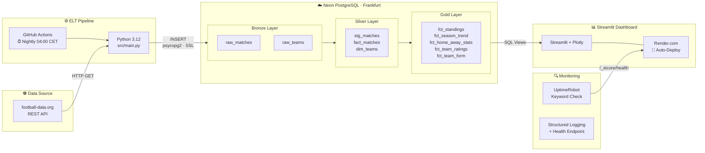

# Matchlytics – System Architecture



## Docker

Das Dashboard laeuft als Container (`Dockerfile`, Basis `python:3.12-slim`).

### Health Check

Docker fuehrt alle 30 Sekunden einen Befehl im Container aus. Exit-Code 0 bedeutet `healthy`, sonst `unhealthy`. Kubernetes nutzt spaeter dasselbe Prinzip mit Probes.

Der urspruengliche Check rief `curl` auf. `python:3.12-slim` enthaelt `curl` nicht, der Check schlug deshalb immer fehl (`/bin/sh: 1: curl: not found`), obwohl Streamlit lief. Der Check ist jetzt ein Python-Einzeiler mit `urllib` aus der Standardbibliothek und braucht kein zusaetzliches Werkzeug:

```dockerfile
HEALTHCHECK --interval=30s --timeout=5s --start-period=30s --retries=3 \
  CMD python -c "import urllib.request; urllib.request.urlopen('http://localhost:8501/_stcore/health', timeout=3)" || exit 1
```

`--start-period` gibt Streamlit Zeit zum Starten, Fehlversuche in dieser Phase zaehlen noch nicht.

### Image-Groesse

| Stand | Groesse |
|---|---|
| Vorher (curl-Check, mit `gcc` und `libpq-dev`) | 1,11 GB |
| Nur Health-Check repariert | 1,11 GB |
| Zusaetzlich `gcc`/`libpq-dev` entfernt, `venv/` in `.dockerignore` | 723 MB |

`gcc` und `libpq-dev` werden nur gebraucht, wenn `psycopg2` aus dem Quellcode gebaut wird. Wir installieren `psycopg2-binary`, ein fertiges Wheel mit eigener libpq. Die Einsparung von rund 390 MB (etwa 35 %) kommt fast vollstaendig aus dem entfernten apt-Schritt. Der Health-Check-Fix aendert nur Metadaten und damit nicht die Groesse.

### Layer-Cache

Docker baut ein Image Schicht fuer Schicht und ueberspringt eine Schicht, wenn sich Befehl und Eingaben nicht geaendert haben. Deshalb wird `requirements.txt` vor dem restlichen Code kopiert: Eine Aenderung in `src/` invalidiert nur `COPY . .` und alles danach, der langsame `pip install`-Schritt bleibt im Cache.
