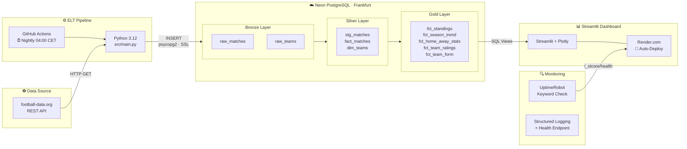

# Matchlytics – System Architecture



## Docker

Das Dashboard laeuft als Container (`Dockerfile`, Basis `python:3.12-slim`).

### Health Check

Docker fuehrt alle 30 Sekunden einen Befehl im Container aus. Exit-Code 0 bedeutet `healthy`, sonst `unhealthy`. Kubernetes nutzt spaeter dasselbe Prinzip mit Probes.

Der urspruengliche Check rief `curl` auf. `python:3.12-slim` enthaelt `curl` nicht, der Check schlug deshalb immer fehl (`/bin/sh: 1: curl: not found`), obwohl Streamlit lief. Der Check ist jetzt ein Python-Einzeiler mit `urllib` aus der Standardbibliothek und braucht kein zusaetzliches Werkzeug:

```dockerfile
HEALTHCHECK --interval=30s --timeout=5s --start-period=30s --retries=3 \
  CMD python -c "import urllib.request; urllib.request.urlopen('http://localhost:8501/_stcore/health', timeout=3)" || exit 1
```

`--start-period` gibt Streamlit Zeit zum Starten, Fehlversuche in dieser Phase zaehlen noch nicht.

### Image-Groesse

| Stand | Groesse |
|---|---|
| Vorher (curl-Check, mit `gcc` und `libpq-dev`) | 1,11 GB |
| Nur Health-Check repariert | 1,11 GB |
| Zusaetzlich `gcc`/`libpq-dev` entfernt, `venv/` in `.dockerignore` | 723 MB |

`gcc` und `libpq-dev` werden nur gebraucht, wenn `psycopg2` aus dem Quellcode gebaut wird. Wir installieren `psycopg2-binary`, ein fertiges Wheel mit eigener libpq. Die Einsparung von rund 390 MB (etwa 35 %) kommt fast vollstaendig aus dem entfernten apt-Schritt. Der Health-Check-Fix aendert nur Metadaten und damit nicht die Groesse.

### Layer-Cache

Docker baut ein Image Schicht fuer Schicht und ueberspringt eine Schicht, wenn sich Befehl und Eingaben nicht geaendert haben. Deshalb wird `requirements.txt` vor dem restlichen Code kopiert: Eine Aenderung in `src/` invalidiert nur `COPY . .` und alles danach, der langsame `pip install`-Schritt bleibt im Cache.


## API

Zwischen Dashboard und Datenbank sitzt eine REST-API mit FastAPI (`src/api/`). Sie stellt die Gold-Views als Endpoints bereit. Das Dashboard soll künftig nur noch mit der API sprechen und braucht dann weder SQLAlchemy noch Datenbank-Zugangsdaten.

### Aufbau

| Datei | Aufgabe |
|---|---|
| `src/api/main.py` | Die App, `/health`, `/ready` und der Handler, der eine nicht erreichbare Datenbank als `503` meldet |
| `src/api/deps.py` | Datenbankverbindung als Dependency (`get_db`), die Engine wird einmal erstellt |
| `src/api/params.py` | Wiederverwendbarer Parameter `Season` (genau vier Ziffern) und die Prüfung `require_season` (404) |
| `src/api/schemas.py` | Pydantic-Modelle für alle Antworten |
| `src/api/routers/meta.py` | `/status`, `/seasons`, `/teams` |
| `src/api/routers/gold.py` | `/standings`, `/season-trend`, `/team-form`, `/home-away`, `/ratings`, `/matches`, `/highlights` |

Die automatische Dokumentation (OpenAPI/Swagger) steht unter `/docs`.

### Endpoints

| Endpoint | Parameter | Antwort |
|---|---|---|
| `GET /health` | | `{"status": "ok"}`, ohne Datenbankzugriff |
| `GET /ready` | | `SELECT 1`, bei nicht erreichbarer Datenbank `503` |
| `GET /status` | | Zähler und Zeitpunkt des letzten abgeschlossenen Spiels |
| `GET /seasons` | | Alle Saisons, neueste zuerst |
| `GET /teams` | `season` | Teams einer Saison |
| `GET /standings` | `season` | Tabelle |
| `GET /season-trend` | `season`, `team` (optional, mehrfach) | Punkteverlauf je Spieltag |
| `GET /team-form` | `season`, `team` (optional, mehrfach) | Letzte fünf Ergebnisse |
| `GET /home-away` | `season` | Heim- und Auswärtsbilanz |
| `GET /ratings` | `season` | Offensiv- und Defensivwerte |
| `GET /matches` | `season` | Spielplan |
| `GET /highlights` | `season` | KPIs der Startseite |

### Statuscodes

| Code | Wann |
|---|---|
| `200` | Erfolg |
| `404` | Unbekannte Saison, oder ein angegebenes Team hat keine Daten |
| `422` | Ungültiger oder fehlender Parameter (z. B. `season=abc`), von FastAPI vor jedem Datenbankzugriff abgewiesen |
| `503` | Datenbank nicht erreichbar |

### Datenbankzugriff

Die API verbindet sich mit der Read-only-Rolle `api_ro` und darf nur die Gold-Views, `dim_teams` und `stg_matches` lesen. Die Zähler in `/status` kommen deshalb aus `stg_matches` und `dim_teams` (gleicher Inhalt wie `raw_matches` und `raw_teams`), die Rohtabellen sind gesperrt. Alle Abfragen nutzen Bind-Parameter, Werte stehen nie im SQL-Text.

Gegen SQL-Injection wirken drei Schichten: Die Validierung (`^\d{4}$`) lehnt Werte wie `1;DROP TABLE x` mit `422` ab, Bind-Parameter würden einen durchgerutschten Wert nur als Text behandeln, und `api_ro` darf ohnehin nichts schreiben oder löschen.

### Liveness und Readiness

`/health` fragt nur, ob der Prozess lebt, und greift nicht auf die Datenbank zu. `/ready` prüft zusätzlich die Datenbank. Die Trennung ist wichtig für Kubernetes: Fällt die Datenbank aus, würde ein DB-Check in `/health` die API als tot melden, und Kubernetes würde sie neu starten, obwohl ihr nichts fehlt. So nimmt Kubernetes sie nur aus dem Traffic (`/ready` schlägt fehl), bis die Datenbank wieder da ist.

### Tests

`tests/test_api.py` testet jeden Endpoint ohne Datenbank. Mit `app.dependency_overrides[get_db]` wird die Verbindung durch eine Attrappe ersetzt, die je nach Stichwort im SQL-Text vorbereitete Zeilen liefert. Die Tests prüfen Statuscodes, Parameter und Antwortform, nicht das SQL gegen Postgres. Fehlerfälle (404, 422) laufen für alle Endpoints mit Saison, außerdem `/health` bei toter Datenbank (`200`) und `/ready` (`503`).

### Lokal starten

```bash
kubectl port-forward svc/postgres 5434:5432 -n matchlytics
DB_USER=api_ro DB_PASSWORD="$API_RO_PASSWORD" DB_HOST=localhost DB_PORT=5434 \
  DB_NAME=matchlytics DB_SSLMODE= .venv/bin/uvicorn src.api.main:app --reload
```

### Image

`Dockerfile.api` mit `requirements-api.txt`: nur FastAPI, uvicorn, SQLAlchemy, psycopg2 und der Datenbank-Client, kein Streamlit. Das Image ist 180 MB groß (Dashboard 723 MB, Pipeline 316 MB), läuft als Benutzer `appuser` (UID 10001) und hat einen `HEALTHCHECK` auf `/health` ohne `curl`. In k3s wird es wie das Pipeline-Image importiert:

```bash
docker build -f Dockerfile.api -t matchlytics-api:dev .
docker save matchlytics-api:dev | sudo k3s ctr images import -
```

### Was gewinnt und kostet die API?

Die Zugriffsregeln und das SQL liegen an einem Ort, das Dashboard braucht keine Datenbank-Zugangsdaten mehr, die Rechte lassen sich einschränken (`api_ro`), und weitere Clients können dieselben Daten abrufen. Der Preis: ein Dienst mehr, der betrieben und überwacht werden muss, und ein zusätzlicher Netzwerkschritt, der Latenz bringt.
