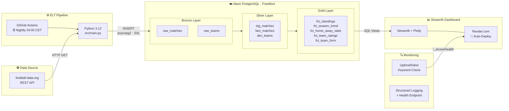
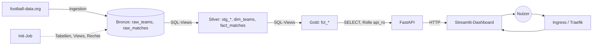
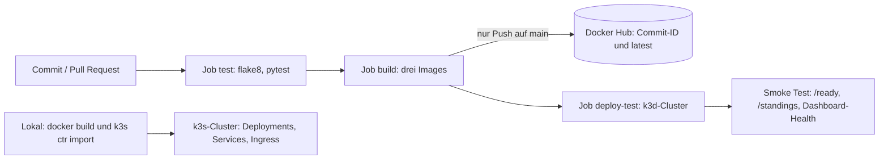
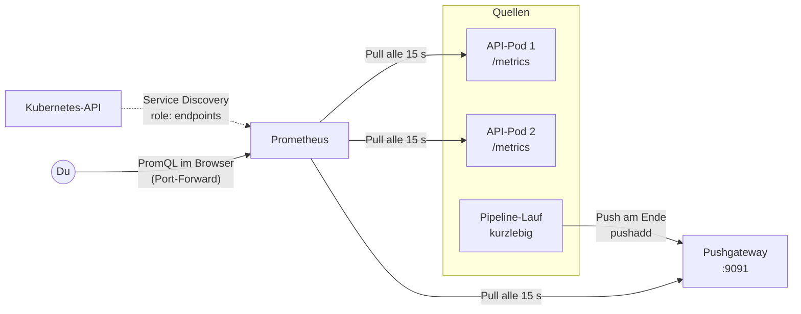

# Matchlytics – System Architecture



## Docker

Das Dashboard laeuft als Container (`Dockerfile`, Basis `python:3.12-slim`).

### Health Check

Docker fuehrt alle 30 Sekunden einen Befehl im Container aus. Exit-Code 0 bedeutet `healthy`, sonst `unhealthy`. Kubernetes nutzt spaeter dasselbe Prinzip mit Probes.

Der urspruengliche Check rief `curl` auf. `python:3.12-slim` enthaelt `curl` nicht, der Check schlug deshalb immer fehl (`/bin/sh: 1: curl: not found`), obwohl Streamlit lief. Der Check ist jetzt ein Python-Einzeiler mit `urllib` aus der Standardbibliothek und braucht kein zusaetzliches Werkzeug:

```dockerfile
HEALTHCHECK --interval=30s --timeout=5s --start-period=30s --retries=3 \
  CMD python -c "import urllib.request; urllib.request.urlopen('http://localhost:8501/_stcore/health', timeout=3)" || exit 1
```

`--start-period` gibt Streamlit Zeit zum Starten, Fehlversuche in dieser Phase zaehlen noch nicht.

### Image-Groesse

| Stand | Groesse |
|---|---|
| Vorher (curl-Check, mit `gcc` und `libpq-dev`) | 1,11 GB |
| Nur Health-Check repariert | 1,11 GB |
| Zusaetzlich `gcc`/`libpq-dev` entfernt, `venv/` in `.dockerignore` | 723 MB |

`gcc` und `libpq-dev` werden nur gebraucht, wenn `psycopg2` aus dem Quellcode gebaut wird. Wir installieren `psycopg2-binary`, ein fertiges Wheel mit eigener libpq. Die Einsparung von rund 390 MB (etwa 35 %) kommt fast vollstaendig aus dem entfernten apt-Schritt. Der Health-Check-Fix aendert nur Metadaten und damit nicht die Groesse.

### Layer-Cache

Docker baut ein Image Schicht fuer Schicht und ueberspringt eine Schicht, wenn sich Befehl und Eingaben nicht geaendert haben. Deshalb wird `requirements.txt` vor dem restlichen Code kopiert: Eine Aenderung in `src/` invalidiert nur `COPY . .` und alles danach, der langsame `pip install`-Schritt bleibt im Cache.


## API

Zwischen Dashboard und Datenbank sitzt eine REST-API mit FastAPI (`src/api/`). Sie stellt die Gold-Views als Endpoints bereit. Das Dashboard soll künftig nur noch mit der API sprechen und braucht dann weder SQLAlchemy noch Datenbank-Zugangsdaten.

### Aufbau

| Datei | Aufgabe |
|---|---|
| `src/api/main.py` | Die App, `/health`, `/ready` und der Handler, der eine nicht erreichbare Datenbank als `503` meldet |
| `src/api/deps.py` | Datenbankverbindung als Dependency (`get_db`), die Engine wird einmal erstellt |
| `src/api/params.py` | Wiederverwendbarer Parameter `Season` (genau vier Ziffern) und die Prüfung `require_season` (404) |
| `src/api/schemas.py` | Pydantic-Modelle für alle Antworten |
| `src/api/routers/meta.py` | `/status`, `/seasons`, `/teams` |
| `src/api/routers/gold.py` | `/standings`, `/season-trend`, `/team-form`, `/home-away`, `/ratings`, `/matches`, `/highlights` |

Die automatische Dokumentation (OpenAPI/Swagger) steht unter `/docs`.

### Endpoints

| Endpoint | Parameter | Antwort |
|---|---|---|
| `GET /health` | | `{"status": "ok"}`, ohne Datenbankzugriff |
| `GET /ready` | | `SELECT 1`, bei nicht erreichbarer Datenbank `503` |
| `GET /status` | | Zähler und Zeitpunkt des letzten abgeschlossenen Spiels |
| `GET /seasons` | | Alle Saisons, neueste zuerst |
| `GET /teams` | `season` | Teams einer Saison |
| `GET /standings` | `season` | Tabelle |
| `GET /season-trend` | `season`, `team` (optional, mehrfach) | Punkteverlauf je Spieltag |
| `GET /team-form` | `season`, `team` (optional, mehrfach) | Letzte fünf Ergebnisse |
| `GET /home-away` | `season` | Heim- und Auswärtsbilanz |
| `GET /ratings` | `season` | Offensiv- und Defensivwerte |
| `GET /matches` | `season` | Spielplan |
| `GET /highlights` | `season` | KPIs der Startseite |

### Statuscodes

| Code | Wann |
|---|---|
| `200` | Erfolg |
| `404` | Unbekannte Saison, oder ein angegebenes Team hat keine Daten |
| `422` | Ungültiger oder fehlender Parameter (z. B. `season=abc`), von FastAPI vor jedem Datenbankzugriff abgewiesen |
| `503` | Datenbank nicht erreichbar |

### Datenbankzugriff

Die API verbindet sich mit der Read-only-Rolle `api_ro` und darf nur die Gold-Views, `dim_teams` und `stg_matches` lesen. Die Zähler in `/status` kommen deshalb aus `stg_matches` und `dim_teams` (gleicher Inhalt wie `raw_matches` und `raw_teams`), die Rohtabellen sind gesperrt. Alle Abfragen nutzen Bind-Parameter, Werte stehen nie im SQL-Text.

Gegen SQL-Injection wirken drei Schichten: Die Validierung (`^\d{4}$`) lehnt Werte wie `1;DROP TABLE x` mit `422` ab, Bind-Parameter würden einen durchgerutschten Wert nur als Text behandeln, und `api_ro` darf ohnehin nichts schreiben oder löschen.

### Liveness und Readiness

`/health` fragt nur, ob der Prozess lebt, und greift nicht auf die Datenbank zu. `/ready` prüft zusätzlich die Datenbank. Die Trennung ist wichtig für Kubernetes: Fällt die Datenbank aus, würde ein DB-Check in `/health` die API als tot melden, und Kubernetes würde sie neu starten, obwohl ihr nichts fehlt. So nimmt Kubernetes sie nur aus dem Traffic (`/ready` schlägt fehl), bis die Datenbank wieder da ist.

### Tests

`tests/test_api.py` testet jeden Endpoint ohne Datenbank. Mit `app.dependency_overrides[get_db]` wird die Verbindung durch eine Attrappe ersetzt, die je nach Stichwort im SQL-Text vorbereitete Zeilen liefert. Die Tests prüfen Statuscodes, Parameter und Antwortform, nicht das SQL gegen Postgres. Fehlerfälle (404, 422) laufen für alle Endpoints mit Saison, außerdem `/health` bei toter Datenbank (`200`) und `/ready` (`503`).

### Lokal starten

```bash
kubectl port-forward svc/postgres 5434:5432 -n matchlytics
DB_USER=api_ro DB_PASSWORD="$API_RO_PASSWORD" DB_HOST=localhost DB_PORT=5434 \
  DB_NAME=matchlytics DB_SSLMODE= .venv/bin/uvicorn src.api.main:app --reload
```

### Image

`Dockerfile.api` mit `requirements-api.txt`: nur FastAPI, uvicorn, SQLAlchemy, psycopg2 und der Datenbank-Client, kein Streamlit. Das Image ist 180 MB groß (Dashboard 723 MB, Pipeline 316 MB), läuft als Benutzer `appuser` (UID 10001) und hat einen `HEALTHCHECK` auf `/health` ohne `curl`. In k3s wird es wie das Pipeline-Image importiert:

```bash
docker build -f Dockerfile.api -t matchlytics-api:dev .
docker save matchlytics-api:dev | sudo k3s ctr images import -
```

### Was gewinnt und kostet die API?

Die Zugriffsregeln und das SQL liegen an einem Ort, das Dashboard braucht keine Datenbank-Zugangsdaten mehr, die Rechte lassen sich einschränken (`api_ro`), und weitere Clients können dieselben Daten abrufen. Der Preis: ein Dienst mehr, der betrieben und überwacht werden muss, und ein zusätzlicher Netzwerkschritt, der Latenz bringt.

## Dashboard und Datenzugriff

Das Dashboard holt seine Daten ausschließlich über `src/utils/data_loaders.py`. Die Seiten und `filters.py` enthalten keinen Datenbankzugriff mehr.

```
Seiten  ->  data_loaders.py  ->  api_client.py  ->  API  ->  Datenbank
                  |
                  +-> (ohne API_URL) direkt die Datenbank, wie bisher
```

### Zwei Betriebsarten

| | Mit `API_URL` | Ohne `API_URL` |
|---|---|---|
| Datenquelle | Matchlytics-API | direkt die Datenbank |
| Einsatz | Kubernetes-Cluster, Docker Compose | Produktion auf Render mit Neon |
| Image / Abhängigkeiten | `Dockerfile.dashboard`, `requirements-dashboard.txt` (ohne SQLAlchemy und psycopg2) | `Dockerfile`, `requirements.txt` |
| `DB_*`-Variablen | nicht nötig | nötig |

Der Schalter ist `api_client.is_enabled()`. Beide Wege liefern dieselben Spalten und Typen. Mit `API_URL` wird `db_client` und damit SQLAlchemy nie importiert, der direkte Zugriff lädt die Engine erst bei der ersten Abfrage. Geprüft wurde die Gleichheit mit allen Ladefunktionen und allen vier Saisons gegen dieselbe Datenbank: Die Ergebnisse waren Zelle für Zelle identisch.

Die Produktion auf Render bleibt unverändert, weil dort `API_URL` nicht gesetzt ist. Deshalb wurden `Dockerfile` und `requirements.txt` nicht umbenannt oder geändert.

### API-Client und Fehlerbehandlung

`src/utils/api_client.py` hat eine Funktion pro Endpoint, 10 Sekunden Timeout und bis zu zwei Wiederholungen bei vorübergehenden Fehlern (Verbindungsfehler, Timeout, 502, 503, 504). Ein `404` wird nicht wiederholt und als `ApiNotFound` gemeldet, alle anderen Fehler als `ApiError` mit einem verständlichen Satz.

Der Decorator `api_guard` in `data_loaders.py` zeigt bei einem `ApiError` eine Meldung ("Die Daten sind gerade nicht verfügbar. ...") und stoppt die Seite, statt einen Stacktrace zu zeigen. Er liegt außen um die gecachte Funktion, weil Streamlit Ausnahmen nicht zwischenspeichert. Der Status im Footer ist ausgenommen und zeigt bei einem Fehler nur "Offline".

### Caches

| Ebene | Cache | Wirkung |
|---|---|---|
| Dashboard | `st.cache_data(ttl=300)` auf allen Ladefunktionen | Ergebnisse bleiben höchstens fünf Minuten gültig |
| API | keiner | jede Anfrage liest die Datenbank |
| Datenbank | Views, keine Zwischenspeicherung | immer der aktuelle Stand |

Für frische Daten nach der nächtlichen Pipeline zählt allein der Cache im Dashboard: Neue Daten sind nach spätestens fünf Minuten sichtbar.

### Reihenfolge beim Deployment

Erst die API, dann das Dashboard. Ein Dashboard mit `API_URL`, dessen API noch nicht läuft, zeigt auf jeder Seite nur die Fehlermeldung. Wäre die Produktion zuerst umgestellt worden, wäre sie ausgefallen. Mit der zweiten Betriebsart bleibt sie unberührt, bis es dort eine API gibt.

### Warum die Datenbank nur von der API aus erreichbar sein sollte

Die Zugangsdaten liegen nur noch an einer Stelle (bei der API, mit der Read-only-Rolle `api_ro`), das Dashboard-Image enthält weder Datenbankpakete noch Zugangsdaten, und die Angriffsfläche ist kleiner. Im Cluster lässt sich der Datenbankzugriff später auf die API beschränken.

### Lokal starten

```bash
# API (mit Port-Forward auf die Datenbank im Cluster)
kubectl port-forward svc/postgres 5434:5432 -n matchlytics
DB_USER=api_ro DB_PASSWORD="$API_RO_PASSWORD" DB_HOST=localhost DB_PORT=5434 \
  DB_NAME=matchlytics DB_SSLMODE= .venv/bin/uvicorn src.api.main:app --reload

# Dashboard, nur mit API_URL und ohne DB-Zugangsdaten
env -i HOME="$HOME" PATH="$PATH" PYTHONPATH="$PWD" API_URL=http://localhost:8000 \
  .venv/bin/streamlit run src/app.py --server.address 127.0.0.1
```

`PYTHONPATH` wird gebraucht, weil die Seiten `from src.utils...` importieren.

Mit Docker Compose:

```bash
docker compose up --build                  # api und dashboard (API_URL=http://api:8000)
docker compose --profile legacy up app     # bisheriger Einzelcontainer mit direktem DB-Zugriff
```

Der Dienst `api` liest die Datenbank-Zugangsdaten aus `.env`. Zeigt sie auf Neon, liest die API dort. Für den lokalen Betrieb sollten eigene Werte gesetzt werden.

## Gesamtbild

### Datenfluss



- **Bronze, Silver, Gold** sind Tabellen und Views in PostgreSQL. Die Pipeline lädt nur Bronze, alles darüber sind Views.
- Das Dashboard hat keinen Datenbank-Zugang, nur die API liest (mit der Read-only-Rolle `api_ro`).
- Der **Init-Job** bereitet die Datenbank im Cluster vor (siehe [kubernetes.md](kubernetes.md)). In Produktion (Render und Neon) liest das Dashboard weiter direkt aus der Datenbank, weil dort `API_URL` nicht gesetzt ist.

### Weg vom Commit zum laufenden Pod



- Pull Requests durchlaufen `test`, `build` und `deploy-test`, pushen aber nichts.
- Der lokale Cluster bekommt seine Images per Hand importiert. Ein automatisches Ausrollen in einen dauerhaften Cluster gibt es noch nicht, siehe [ci-cd.md](ci-cd.md).

### Monitoring im Cluster



- Die API wird per **Pull** abgefragt. Prometheus findet jeden Pod einzeln über die Kubernetes-API und erkennt neue Pods selbst.
- Die Pipeline läuft nur kurz. Deshalb **schiebt** sie ihr Ergebnis (Dauer, geladene Zeilen, Zeitpunkt des letzten Erfolgs) am Ende zum Pushgateway, und Prometheus holt es dort ab.
- Die Produktion (Render und Neon) hat dieses Monitoring nicht. Dort prüft UptimeRobot den Health-Endpoint, siehe das erste Diagramm. Details zu Metriken und Abfragen: [monitoring.md](monitoring.md).
